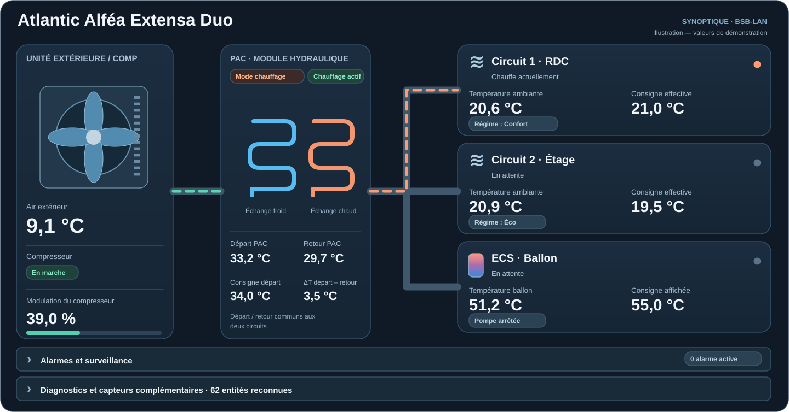

# Atlantic Alfea BSB-LAN pour Home Assistant

Intégration personnalisée Home Assistant pour piloter et surveiller une pompe à chaleur **Atlantic Alféa Extensa Duo** via **BSB-LAN**.

> Version actuelle : **1.5.7**


## Aperçu de la carte Lovelace



*Illustration de l'interface avec des valeurs fictives, pour présenter l'organisation des informations. La carte réelle utilise les capteurs de votre installation.*

Le synoptique est **en lecture seule** : il présente les états du compresseur, de la PAC, des circuits de chauffage/rafraîchissement et de l'ECS, avec alarmes et diagnostics repliables. Son éditeur Lovelace permet de choisir une apparence **Automatique / Claire / Sombre** selon le thème Home Assistant.


## Matériel de référence

Cette intégration a été développée et testée sur une **Atlantic Alféa Extensa Duo** équipée d'un régulateur / carte **RVS21.831F** (**famille 211, variante 127**).

D'autres modèles Atlantic Alféa ou d'autres variantes de régulateurs Siemens RVS peuvent être compatibles, mais ils ne sont pas considérés comme validés tant que les paramètres BSB-LAN correspondants n'ont pas été vérifiés.

## Fonctionnalités

- Mode global de la PAC : **Off / Chauffage / Refroidissement**. Une commande globale active les deux circuits dans le mode demandé ou les arrête tous les deux, avec vérification des retours d'état BSB-LAN.
- Deux entités Climate indépendantes : **C1 - Circuit 1** et **C2 - Circuit 2**, avec commandes locales Chauffage / Refroidissement / Off.
- Températures ambiantes et consignes effectives des circuits.
- Prise en compte des régimes Confort / Réduit (Éco) du régulateur.
- Réglage depuis Home Assistant des **huit consignes programmées** Confort / Éco (chauffage et rafraîchissement sur C1 et C2), sans modifier les horaires de la PAC.
- Dérogations temporaires natives en chauffage (**Plus chaud / Plus froid**) et en rafraîchissement (**Plus froid**, sens validé), avec durée paramétrable et retour au programme interne.
- Quatre capteurs de diagnostic supplémentaires en lecture seule : régime temporaire et programme actif pour C1 et C2.
- Libellés raccourcis et homogènes : **C1, C2, PAC, ECS, COMP**.
- Gestion et suivi de l'**ECS** : mode, température ballon, état de charge, pompe et appoint électrique lorsque les paramètres sont disponibles.
- État et modulation du compresseur.
- Températures départ, retour, consigne départ et température extérieure.
- Compteur d'énergie totale BSB-LAN.
- Suivi des heures et démarrages du compresseur.
- Diagnostics : cycles courts, redémarrages rapprochés, démarrages fréquents et écart départ/consigne.
- Lecture de l'horloge PAC, détection d'une désynchronisation et bouton de synchronisation avec Home Assistant.
- Détection automatique des entités BSB-LAN avec possibilité de corriger l'association manuellement.

## Carte Lovelace synoptique incluse (V1.5.7)

La carte **PAC Synoptique** est incluse dans l'intégration et installée par HACS, dans
`custom_components/atlantic_alfea_controller/www/pac-synoptique-card.js`.
Elle est **strictement en lecture seule** (COMP, PAC, chauffage RDC/Étage,
ECS, alarmes repliables, diagnostics et animations liées aux états).

Après la mise à jour via HACS, **redémarrez Home Assistant**, puis dans
**Paramètres → Tableaux de bord → Ressources**, ajoutez **une seule fois** la
ressource de type **Module JavaScript** :

```text
/alfea-synoptique/pac-synoptique-card.js?v=1.5.7
```

### Éditeur visuel (nouveau en V1.5.7)

Une fois le module JavaScript chargé, la carte **PAC Synoptique** apparaît dans
le sélecteur de cartes Lovelace. Dans **Modifier la carte**, l'onglet éditeur
visuel propose :

- **Apparence** : Automatique (thème Home Assistant), Clair, Sombre.
- **Afficher les diagnostics complémentaires** : oui/non.

Les réglages sont enregistrés comme configuration normale du dashboard,
sans éditer le YAML. Le synoptique n'ajoute aucune commande PAC. Les alarmes
et leur nombre restent visibles et repliables quelle que soit l'option.

L'onglet **Disposition** standard de Home Assistant permet d'adapter la
largeur de la carte ; le rendu horizontal reste responsive.

### Configuration YAML facultative

Dans le YAML d'une carte manuelle :

```yaml
type: custom:pac-synoptique-card
title: Atlantic Alféa Extensa Duo
show_diagnostics: true
grid_options:
  columns: full
  rows: auto
theme_mode: auto  # auto (défaut), light, dark
```

**Thèmes :** `theme_mode: auto` reprend les couleurs du thème Home Assistant
et suit son basculement clair/sombre. Si souhaité, `theme_mode: light` impose une
carte claire, et `theme_mode: dark` impose le graphisme sombre d'origine.
Cette option est purement visuelle, sans effet sur les consignes ou la régulation.

**Migration depuis la carte installée manuellement :** supprimez l'ancienne
ressource `/local/pac-synoptique-card.js?v=...` afin de ne pas charger
deux versions de `pac-synoptique-card`. La configuration YAML ne change pas.

La carte ne contient aucun appel de service Home Assistant et **ne commande pas
la PAC**. Les couleurs/animations restent indicatives : pas de débitmètre,
pas de pression frigorifique ni de puissance instantanée inventés.
Voir [la documentation synoptique](docs/SYNOPTIQUE_V155.md).

## Régime Confort / Éco (affichage uniquement)

Les diagnostics BSB-LAN natifs `10112` (C1) et `10122` (C2) sont
utilisés en priorité pour afficher le programme appliqué :
**1 = Allure Réduit / Éco**, **2 = Allure Confort**.
En leur absence, le libellé de l'état BSB est consulté puis
`indéterminé` est conservé si les données ne suffisent pas.
L'état de régulation (`8000/8001`) et le régime horaire sont deux
informations distinctes : `122 - Limitation de la température ambiante`
ne veut **pas** dire Éco en soi.

**Sécurité :** cette nouvelle lecture sert exclusivement à l'affichage.
Les méthodes de choix de consigne et les dérogations natives existantes restent inchangées.

## Dérogation native

La V1.5.0 utilise les dérogations natives du régulateur pour les modifications temporaires demandées depuis les entités Climate, sans réécrire les consignes Confort / Éco ni les horaires.

- **Chauffage :** dérogation vers une température **plus chaude** ou **plus froide** sur chacun des deux circuits.
- **Rafraîchissement :** dérogation vers une température **plus froide**, selon le comportement validé en V1.3.3.
- **Amplitude :** écart de **0,1 à 5 °C** par rapport à la consigne effective au moment de la commande.
- **Durée :** configurée pour chaque circuit et gérée directement par le régulateur ; retour automatique à la programmation normale à l'expiration.
- **Annulation :** bouton dédié à chaque circuit lorsque les paramètres nécessaires sont disponibles en écriture.

Les paramètres personnalisés d'écart `10991` et `10993` peuvent ne pas renvoyer de valeur lisible, même après écriture : cela ne signifie pas nécessairement que la dérogation a échoué. L'état de dérogation (`701` / `1001`) et les consignes effectives (`8741` / `8771`) permettent d'en contrôler les effets.

**Validation :** les dérogations chauffage et leur expiration après une heure ont été testées sur les deux circuits avec la V1.4.0-beta.5. La commutation saisonnière réelle depuis le mode global de la V1.5.0 reste à confirmer sur l'installation.

## Philosophie de fonctionnement

La programmation horaire reste gérée par la PAC. L'intégration ne remplace pas le programmateur du régulateur et conserve la PAC comme source de vérité pour les régimes Confort / Réduit.

Le **mode global** commande les deux circuits à la fois : **Chauffage** active C1 et C2 en chauffage ; **Refroidissement** active les deux en rafraîchissement ; **Off** arrête les deux circuits. Après une commande globale, chaque circuit peut de nouveau être piloté indépendamment depuis sa carte Climate. La transition de saison est effectuée en désactivant d'abord le mode opposé, puis en activant le mode demandé, avec confirmation des états BSB-LAN. La commutation saisonnière physique doit encore être validée sur la PAC.

## Prérequis

- Home Assistant avec MQTT fonctionnel.
- Une passerelle **BSB-LAN** déjà intégrée à Home Assistant.
- Les paramètres BSB nécessaires publiés sous forme d'entités Home Assistant.

L'intégration détecte automatiquement les paramètres connus. Les paramètres obligatoires qui ne peuvent pas être associés sans ambiguïté sont demandés pendant la configuration.

## Installation via HACS (dépôt personnalisé)

Le dépôt est compatible avec HACS en tant que **Custom Repository**.

1. Dans Home Assistant, ouvrez **HACS**.
2. Ouvrez le menu **⋮** en haut à droite puis **Custom repositories**.
3. Ajoutez l'URL du dépôt :

   `https://github.com/Jrmysmallstep/home-assistant-atlantic-alfea-bsb-lan`

4. Sélectionnez le type **Integration**.
5. Cliquez sur **Add**.
6. Recherchez ensuite **Atlantic Alfea BSB-LAN** dans HACS et installez l'intégration.
7. Redémarrez Home Assistant après l'installation.
8. Ouvrez **Paramètres → Appareils et services → Ajouter une intégration** puis recherchez **Atlantic Alfea BSB-LAN**.

HACS installera automatiquement l'intégration dans `custom_components/atlantic_alfea_controller/`.

## Documentation BSB-LAN

La documentation officielle BSB-LAN est la référence principale pour l'installation, la configuration de la passerelle et la compréhension des paramètres du bus :

- **Documentation BSB-LAN en français :** https://docs.bsb-lan.de/fr/index.html

Les numéros de paramètres et leur disponibilité peuvent varier selon le régulateur, le firmware et la configuration de l'installation. En cas de doute, vérifiez toujours le paramètre concerné dans la documentation BSB-LAN et directement sur votre régulateur.

## Installation manuelle

Si vous ne souhaitez pas utiliser HACS :

1. Copiez le dossier :

   `custom_components/atlantic_alfea_controller/`

   dans le dossier `custom_components` de votre configuration Home Assistant.

2. Vous devez obtenir :

   `/config/custom_components/atlantic_alfea_controller/manifest.json`

3. Redémarrez Home Assistant.
4. Ouvrez **Paramètres → Appareils et services → Ajouter une intégration**.
5. Recherchez **Atlantic Alfea BSB-LAN**.
6. Laissez la détection automatique associer les paramètres BSB-LAN, puis vérifiez les éventuels paramètres non détectés.

## Principaux paramètres BSB-LAN

| Fonction | Circuit 1 | Circuit 2 |
|---|---:|---:|
| Mode chauffage | 700 | 1000 |
| Consigne chauffage Confort | 710 | 1010 |
| Consigne chauffage Réduit | 712 | 1012 |
| Mode rafraîchissement | 901 | 1201 |
| Consigne rafraîchissement Confort | 902 | 1202 |
| Consigne rafraîchissement Réduit | 903 | 1203 |
| Température ambiante | 8740 | 8770 |
| Consigne ambiante effective | 8741 | 8771 |
| État chauffage | 8000 | 8001 |
| État rafraîchissement | 8004 | 8025 |
| État dérogation | 701 | 1001 |
| Durée dérogation (paramètre personnalisé) | 10990 | 10992 |
| Écart dérogation (paramètre personnalisé) | 10991 | 10993 |
| Régime temporaire (diagnostic) | 10110 | 10120 |
| Programme horaire actif (diagnostic) | 10112 | 10122 |

Autres paramètres importants :

- `0` : date et heure de la PAC
- `1600` : mode ECS
- `1610` : consigne nominale ECS
- `1612` : consigne réduite ECS
- `8003` : état ECS
- `8006` : état général générateur/PAC
- `8400` : état compresseur
- `8410` : température retour PAC
- `8411` : consigne départ PAC
- `8412` : température départ PAC
- `8413` : modulation compresseur
- `8450` : heures compresseur
- `8451` : nombre de démarrages compresseur
- `8700` : température extérieure
- `8820` : pompe ECS
- `8821` : appoint électrique ECS
- `8830` : température ballon ECS
- `3113` : énergie électrique totale

## Diagnostics de programmation (V1.5.0)

Quatre nouveaux capteurs **en lecture seule** complètent la surveillance des circuits :

| Entité affichée | Paramètre BSB-LAN | Information |
|---|---:|---|
| C1 - Régime temporaire | `10110` | Régime temporaire du circuit 1 |
| C2 - Régime temporaire | `10120` | Régime temporaire du circuit 2 |
| C1 - Programme actif | `10112` | Allure actuellement appliquée (Confort / Réduit) |
| C2 - Programme actif | `10122` | Allure actuellement appliquée (Confort / Réduit) |

Ces valeurs dépendent de la disponibilité et de la publication des paramètres par BSB-LAN. Les capteurs ne changent jamais les programmes horaires.

## Mise à jour des données

L'intégration demande périodiquement à BSB-LAN de republier certains diagnostics qui doivent rester frais :

- `8411` toutes les 5 minutes ;
- `3113`, `8450` et `8451` toutes les 15 minutes ;
- l'horloge (`0`) une fois par heure.

Ces demandes sont des lectures et ne modifient pas les réglages de la PAC.

## Avertissement

Projet communautaire non officiel, sans affiliation avec Atlantic ou le projet BSB-LAN. Les comportements de certains paramètres peuvent varier selon les variantes du régulateur. Le changement de saison et le nouveau mode global nécessitent encore une validation complète sur l'installation réelle ; les tests automatiques ne remplacent pas les essais sur la PAC.
